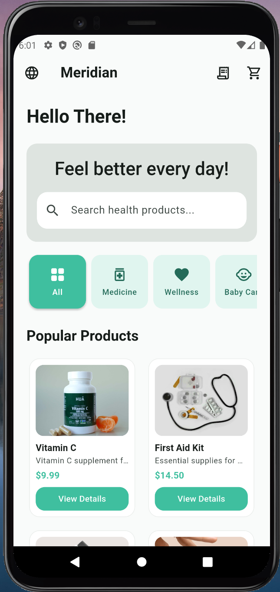
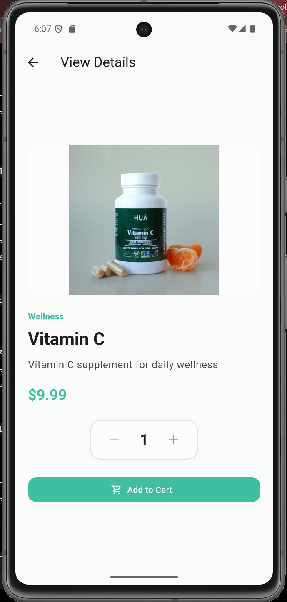
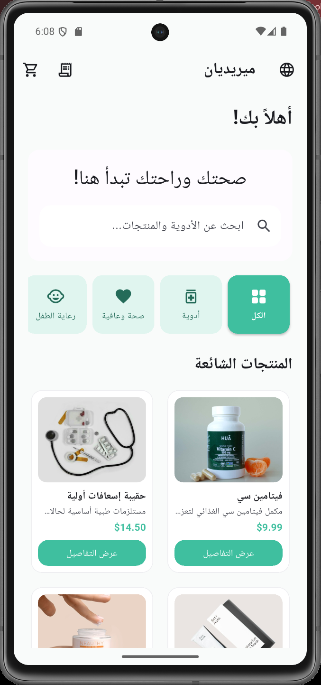
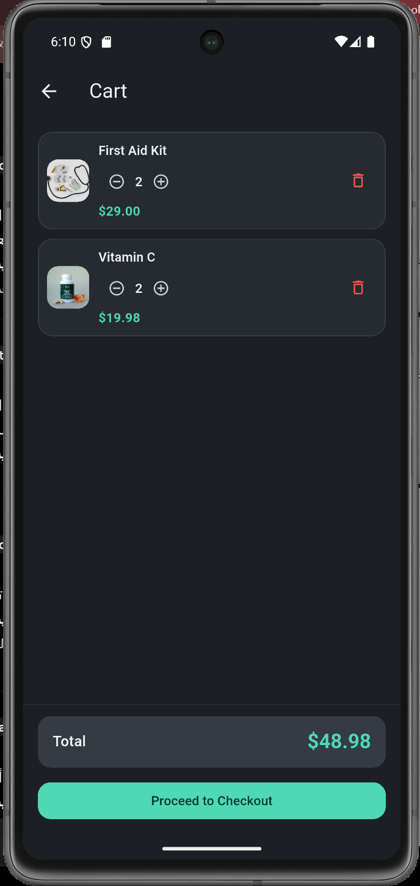
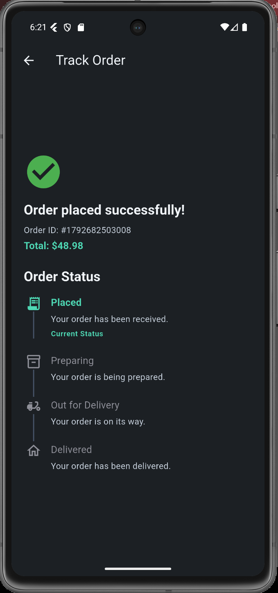
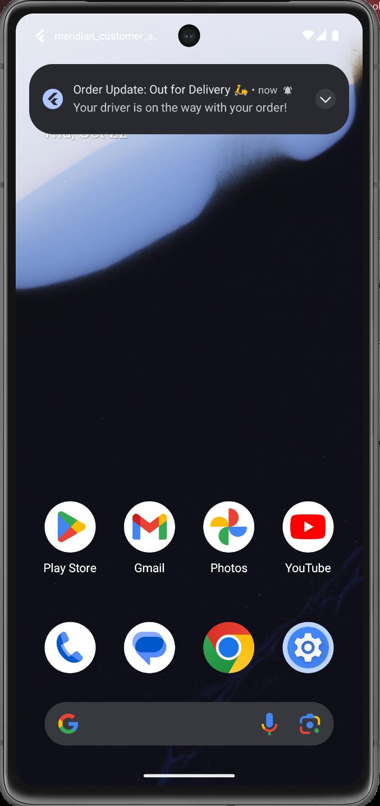
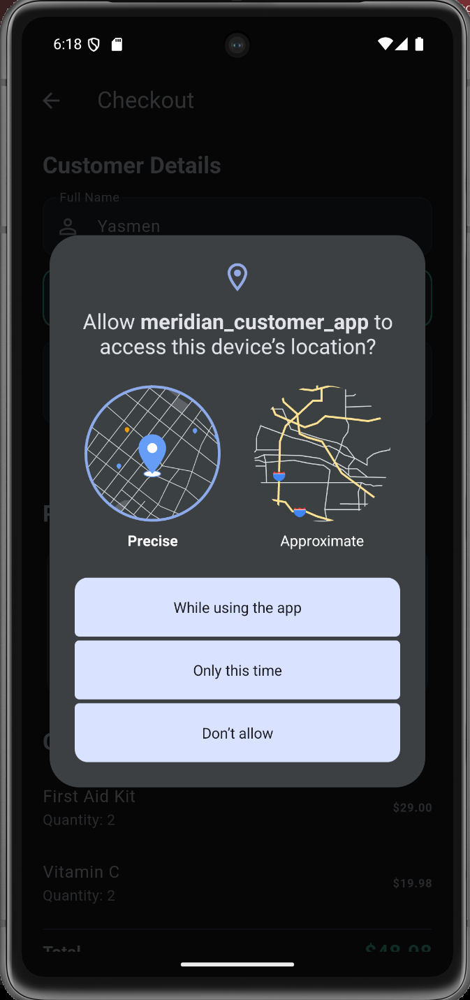
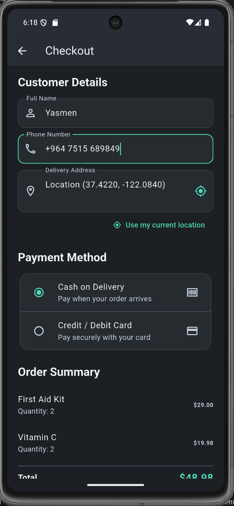

# Meridian Customer App - Cross-Version Android Storefront (Flutter)

A cross-version, modern pharmacy storefront customer application built with flutter for **AYC IT Healthcare**. Designed and Engineered to deliver a seamless, responsive, and robust customer joureny across Android versions ranging from **Android 10 (API 29)** through **Android 16 (API 36)**.

---

## Key Features & Customer Joureny

1. Browse & Category Filtering: Explore OTC products across categories (*Medicine, Wellness, Baby Care..*) with real-time keyword search.
2. Product Details: Rich product cards with dynamic imagery, pricing, and responsive quantity adjustment.
3. Cart & State Management: Dynamic cart updates with quantity control, item removal, and auto-computed pricing using `Provider`.
4. Checkout & Geolocation:
   - Multi-field input validation (name, phone, address).
   - Mock payment methods (Cash on delivery, and Card).
   - "Use my current location" powered by 'geolocator' with local GPS/network fallback and permission handling.
5. Real-time order tracking & Notification: 
   - Visual step-by-step delivery timeline ('Placed -> Preparing -> Out for Delivery -> Delivered').
   - Simulated background status updates that reflect across the app and on 'My orders' dashboard. 
   - High-priority system heads-up notifications that trigger even when the app is completey terminated.
6. Bilingual support & Full RTL:
   - Instant language switching between English (LTR) and Arabic (RTL) via in-app toggle.
   - Comperhensive UI mirroring and localized strings across the entire user joureny.


---

## Architecture & State Management:

The application is structured following a clean, feature-driver architecture:
```lib/
├── core/
│   ├── localization/
│   │   ├── app_translations.dart
│   │   └── locale_controller.dart
│   ├── services/
│   │   └── notification_service.dart
│   └── theme/
│       └── app_theme.dart
└── features/
    ├── cart/
    │   ├── controllers/
    │   │   └── cart_controller.dart
    │   └── screens/
    │       └── cart_screen.dart
    ├── checkout/
    │   └── screens/
    │       └── checkout_screen.dart
    ├── home/
    │   └── home_screen.dart
    ├── orders/
    │   ├── controllers/
    │   │   └── order_controller.dart
    │   ├── models/
    │   │   └── order.dart
    │   └── screens/
    │       ├── my_orders_screen.dart
    │       └── order_tracking_screen.dart
    └── products/
        ├── data/
        │   └── product_repo.dart
        ├── models/
        │   └── product.dart
        ├── screens/
        │   └── product_details_screen.dart
        └── widgets/
            └── product_card.dart
```
### Why Provider?
`Provider` (`changeNotifier`) was chosen for state management because:
   - Clean separation of concerns: Keeps UI screens declarative and business logic testable.
   - Global lifecycle persistence: Orders and simulation timer live in `OrderController` at the app root (`MultiProvider`), ensuring order tracking and UI reactivity persist seamlessly when navigating between screens.
   - Efficieny & lightweight footpring: Optimal performance across low-end and high-end Android devices without unnecessary overhead. 

---

## Cross-Version Android Compatibility Matrix

| Feature | Android 10 (API 29) | Android 12 (API 31) | Android 13 (API 33) | Android 16 (API 36) | Status |
| :--- | :---: | :---: | :---: | :---: | :---: |
| Material 3 Dynamic Color | ✓ (Fallback) | ✓ (Harmonized) | ✓ (Harmonized) | ✓ (Harmonized) | Pass |
| Light & Dark Theme | ✓ | ✓ | ✓ | ✓ | Pass |
| Bilingual Support (En, Ar) & RTL | ✓ | ✓ | ✓ | ✓ | Pass |
| Runtime Notification Permission | Not Required | Not Required | ✓ Requested | ✓ Requested | Pass |
| Background / Closed Notifications | ✓ | ✓ | ✓ | ✓ | Pass |
| Current Location (GPS & Mock) | ✓ | ✓ | ✓ | ✓ | Pass |
| Approximate vs Precise Location | ✓ | ✓ | ✓ | ✓ | Pass |
| Edge-to-Edge & Gesture Navigation | ✓ (3-Button) | ✓ (Gesture) | ✓ (Gesture) | ✓ (Enforced) | Pass |
| Adaptive Screen Layouts | ✓ | ✓ | ✓ | ✓ | Pass |
  

## Screenshots and Visual Evidence

| Android 10 (Branded Fallback & 3-Button Nav) | Android 16 (Modern UI & Edge-to-Edge) |
| :---: | :---: |
|  |  |

| Arabic RTL Layout | Dark Theme (Cart Screen) |
| :---: | :---: |
|  |  |

| Order Tracking Flow | Heads-Up Notification Banner |
| :---: | :---: |
|  |  |

| Location Permission (Approximate vs Precise) | Checkout & Geolocation Autofill |
| :---: | :---: |
|  |  |

---


## Issues Found & How They Were Resolved

### 1. Dynamic Colors Conflicting with Brand Identity (Android 12+)

- **Problem:** Dynamic color extraction from the user's wallpaper could introduce unexpected color variations, such as blue-toned primary elements, which conflicted with Meridian's green brand identity.

- **Solution:** Used color harmonization where supported and explicitly configured key theme roles and button styles to preserve the brand's primary green (`#3FBF9F`) while retaining a coordinated Material 3 color palette.

### 2. Android Emulator Location Timeout

- **Problem:** Location requests could time out when the emulator did not provide a suitable location fix through the requested provider or accuracy level.

- **Solution:** Improved the location retrieval flow by checking the last known position, attempting a current location request with an appropriate accuracy setting, and providing manual address entry as a fallback.

### 3. Order Simulation Lifecycle

- **Problem:** Order status simulation could stop when its timer was tied to the lifecycle of the order-tracking screen and the user navigated away.

- **Solution:** Moved order state management and simulation into `OrderController`, allowing order progression to continue independently of the tracking screen's lifecycle while the application process remains active. OS-scheduled local notifications were configured separately for scheduled status updates.

### 4. Android 13+ Notification Presentation

- **Problem:** Order status notifications could appear silently in the notification tray instead of displaying a heads-up alert.

- **Solution:** Reviewed the notification channel importance, notification priority, channel configuration, and runtime `POST_NOTIFICATIONS` permission. A new channel ID was used where necessary to apply updated channel settings during testing.


---


## AI Usage Disclosure
In alignment with the assignment guidelines, AI tools (**Google Antigravity / Gemini & Claude**) were utilized as an engineering assistant for productivity and boilerplate acceleration:

   - **Localization & Content Translation:** Accelerating the translation and localization dictionary (`app_translations.dart`) from English to Arabic, ensuring accurate medical and e-commerce terminology without manual translation overhead.

   - **Mock Catalog Generation:** Generating the sample dataset in `assets/data/products.json` with realistic mock pharmacy inventory, descriptions, categories, and image references for testing and demonstration purposes.

   - **Advanced Notification Architecture:** Assisting with the low-level Android configuration for OS-scheduled notifications (integrating `zonedSchedule` with `flutter_local_notifications`, timezone initialization, boot receiver permissions, and Android 13+ heads-up notification channels).


*All architectural decisions, state management workflows, layout implementations, and final code integrations were reviewed, customized, and verified manually.*


---

## 🧪 Running Widget Tests
To verify that all widget tests pass:
```bash
flutter test
```

Expected output:
```text
All tests passed!
```

---

## 📦 How to Build the APK
To build a standalone installable APK:
```bash
flutter build apk --debug
```
Output path: `build/app/outputs/flutter-apk/app-debug.apk`
